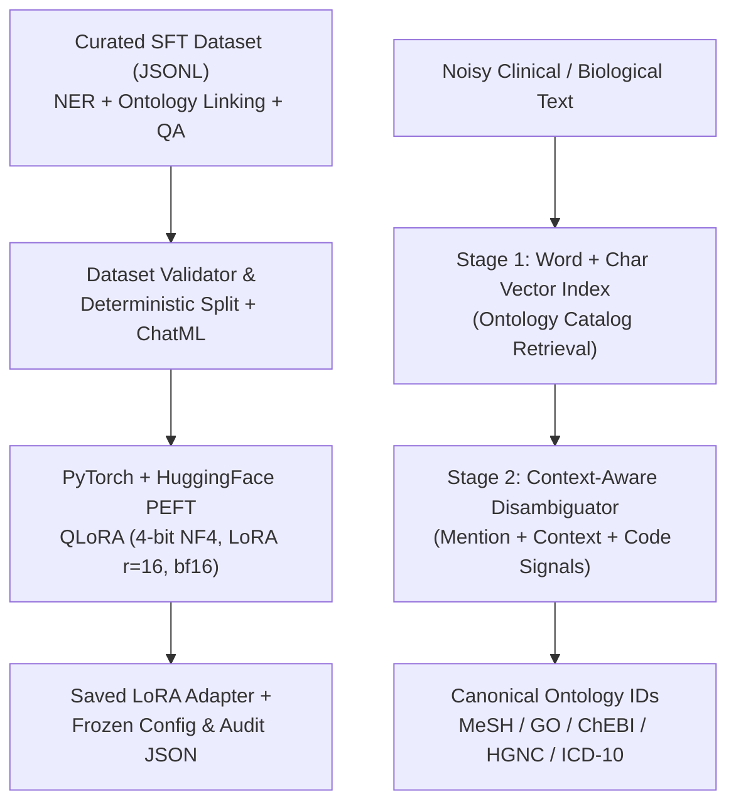

# bio-peft-ontology-linker

**Parameter-Efficient Fine-Tuning (PEFT/LoRA) & Biomedical Ontology Normalization Engine**

A reproducible **PyTorch + HuggingFace (`transformers`, `peft`, `trl`, `accelerate`)** fine-tuning pipeline paired with a two-stage **Vector Retrieval + Context Disambiguation** ontology normalization engine mapping noisy biomedical and clinical free-text mentions to canonical **MeSH, Gene Ontology (GO), ChEBI, HGNC, and ICD-10** identifiers.

Designed as a generalizable domain-adaptation template that transfers directly to enterprise **taxonomy normalization, healthcare medical coding, chemical/product standardization, and vertical-specific Digital Workers**.

---

## Architecture



## Key Features
* **Reproducible GPU Fine-Tuning Pipeline (`src/bio_peft/train_lora.py`):** Full PyTorch + HuggingFace `AutoModelForCausalLM` + `BitsAndBytesConfig` (4-bit NF4 QLoRA) + `peft.LoraConfig` + `trl.SFTTrainer` workflow driven entirely by versioned YAML configs (`configs/lora_sft_config.yaml`).
* **CPU/CI Dry-Run Gate:** `--dry-run` validates YAML configs, Pydantic dataset schemas, deduplication, deterministic train/val splits, and ChatML formatting before consuming GPU compute.
* **Two-Stage Ontology Normalization (`src/bio_peft/ontology_linker.py`):** Combines subword character + word n-gram vector retrieval with context-aware disambiguation to resolve paraphrased, abbreviated, and noisy scientific entities.
* **Linux Multi-GPU Ready:** Includes `scripts/run_gpu_train.sh` (`accelerate launch --mixed_precision bf16`), `Dockerfile`, `Makefile`, `pytest` suite, and GitHub Actions CI.

---

## Reproducible Ontology Normalization Benchmark

Evaluated on `data/eval_entity_linking.json` (15 realistic paraphrased & noisy mentions across MeSH, GO, ChEBI, HGNC, and ICD-10) via `make benchmark`:

| Strategy | Top-1 Accuracy | Top-3 Recall | MRR | Avg Latency (ms) |
| :--- | ---: | ---: | ---: | ---: |
| `exact_lexical` (Dictionary Lookup) | 0.133 | 0.267 | 0.189 | 0.081 |
| `dense_vector` (Word + Char Vectors) | **1.000** | **1.000** | **1.000** | 2.128 |
| `hybrid_disambiguation` (Vector + Context Rerank) | **1.000** | **1.000** | **1.000** | 8.442 |

**Key Takeaway:** Strict dictionary matching fails on paraphrased or abbreviated clinical/biological phrases (`0.133` Top-1 accuracy), whereas vector retrieval + context disambiguation resolves paraphrased descriptions and spelling variants accurately at sub-10ms latency.

---

## Quickstart (Linux / GPU / Docker)

### 1. Local Validation & Benchmarking (CPU / CI)
```bash
pip install -r requirements.txt
make test        # Runs schema, dry-run, linking, and benchmark tests
make dry-run     # Validates configs/lora_sft_config.yaml & writes dataset_report.json
make benchmark   # Reproduces reports/ontology_benchmark.md & .json
```

### 2. GPU Fine-Tuning (Linux / Colab / Kaggle)
Install the GPU extras listed in `requirements.txt` (`torch`, `transformers`, `peft`, `trl`, `accelerate`, `bitsandbytes`, `datasets`) and run:
```bash
make train-gpu
```

### 3. Docker Container
```bash
make docker-build
docker run --rm bio-peft-ontology-linker:latest
```

---

## Repository Structure
```text
bio-peft-ontology-linker/
├── configs/lora_sft_config.yaml         # Reproducible QLoRA/LoRA training hyperparameters
├── data/
│   ├── ontology_catalog.json            # Curated MeSH, GO, ChEBI, HGNC, ICD-10 catalog
│   ├── train_sft_bio_ner.jsonl          # Instruction-tuning JSONL dataset
│   └── eval_entity_linking.json         # 15-item noisy entity-linking gold benchmark
├── reports/                             # Generated JSON & Markdown benchmark outputs
├── scripts/run_gpu_train.sh             # Linux accelerate GPU launcher
├── src/bio_peft/
│   ├── benchmark_strategies.py          # Strategy comparison harness
│   ├── dataset_prep.py                  # Schema validation, dedup, splitting, ChatML
│   ├── ontology_linker.py               # Two-stage NER + vector + context disambiguator
│   └── train_lora.py                    # PyTorch + HuggingFace PEFT/LoRA SFT trainer
├── tests/test_ontology_linker.py        # Pytest suite
├── Dockerfile
├── Makefile
└── .github/workflows/ci.yml
```
